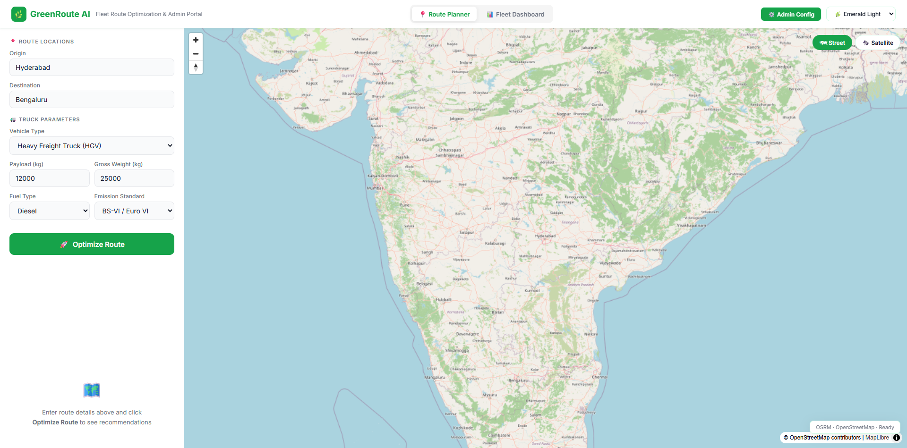
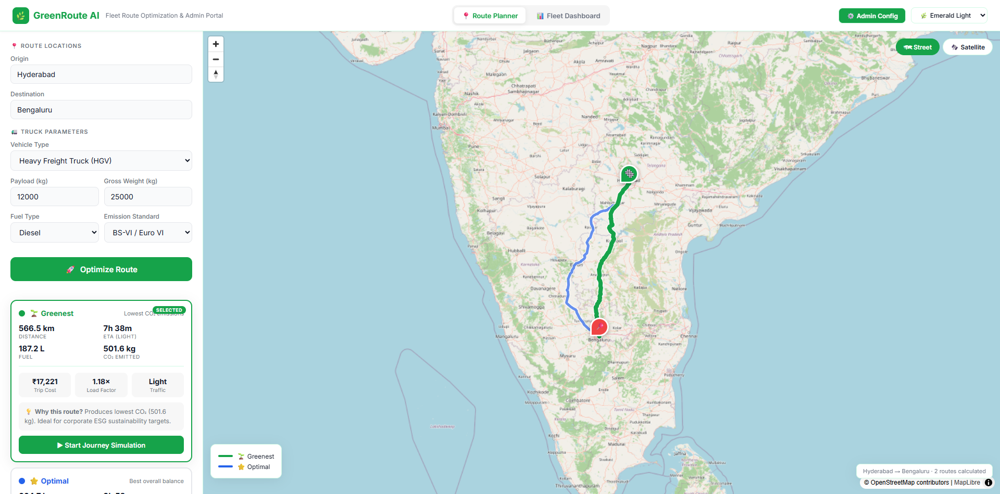
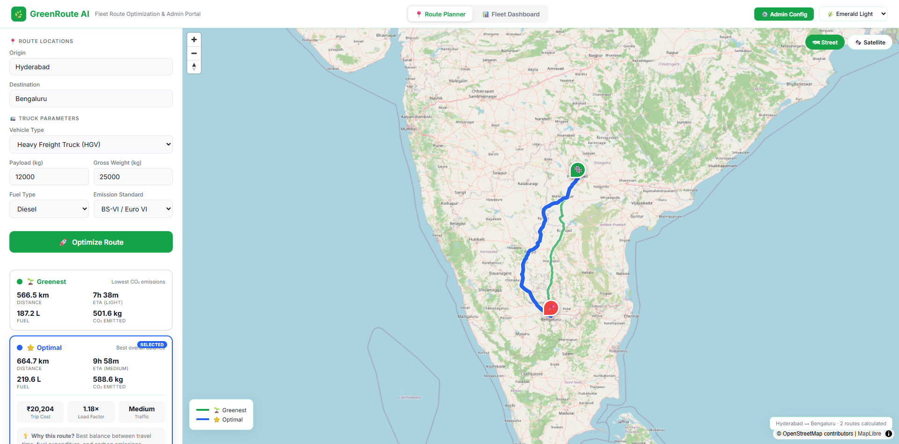
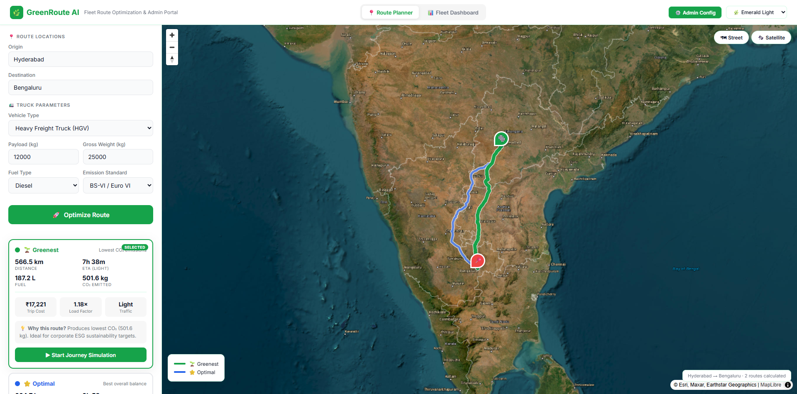
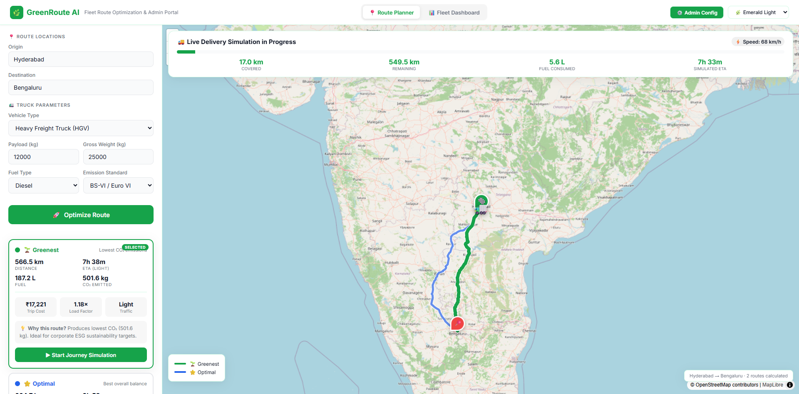
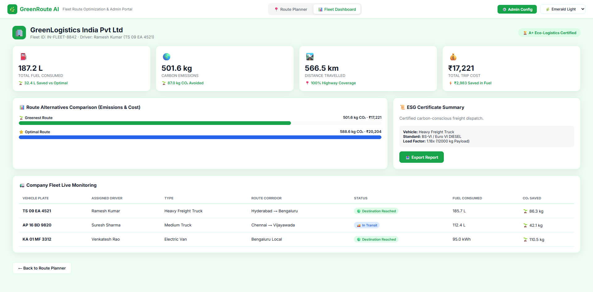
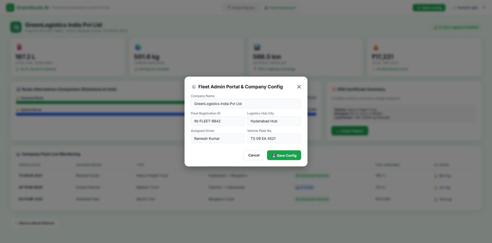
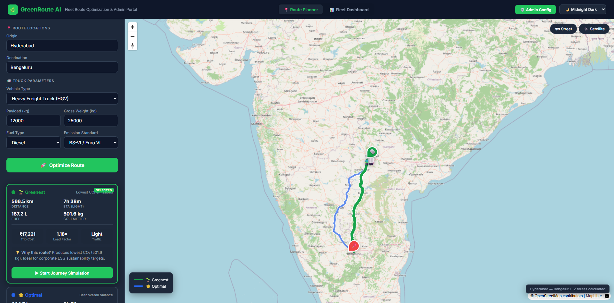
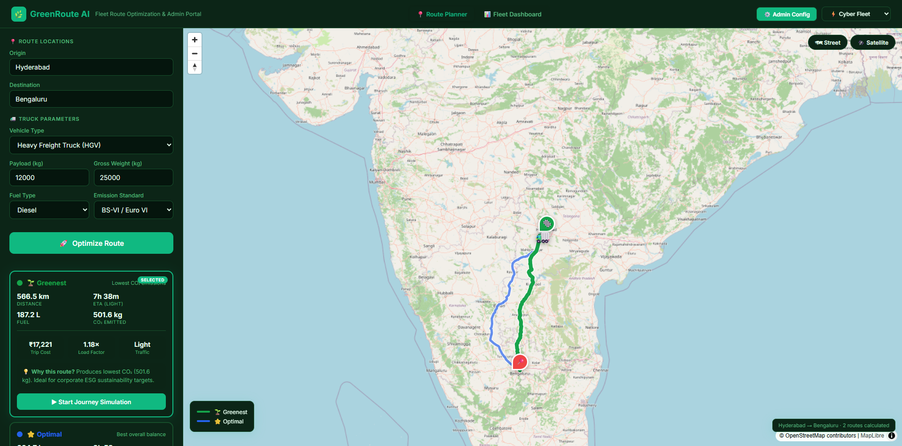
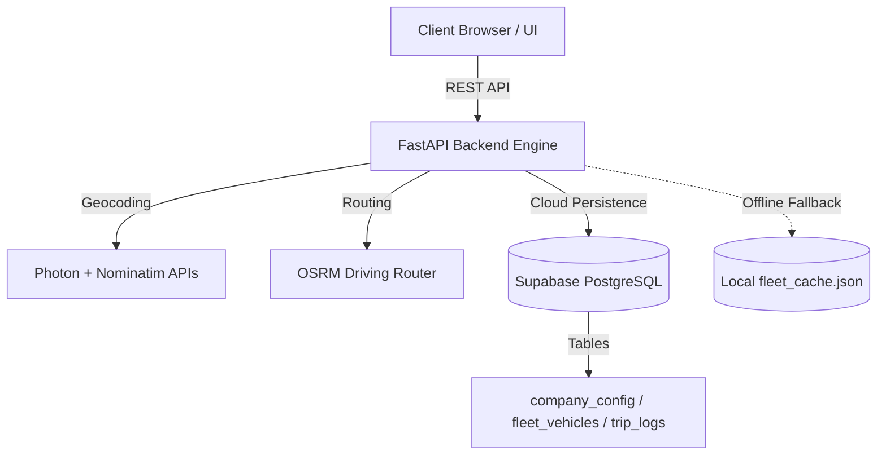

# 🌿 GreenRoute AI — Intelligent Freight Route Optimization Engine

> **Live Production Deployment:** [https://greenroute-7p3n.onrender.com/](https://greenroute-7p3n.onrender.com/)

[](https://python.org)
[](https://fastapi.tiangolo.com)
[](https://supabase.com)
[](https://greenroute-7p3n.onrender.com/)
[](LICENSE)

GreenRoute AI is an enterprise-grade freight route optimization and ESG compliance platform. It models vehicle payloads, gross vehicle weight (GVW), multi-fuel consumption, carbon emission factors (CO₂), and live corridor traffic conditions to compute greenest vs. optimal transit paths.

---

## 🚀 Key Features

* 📍 **Smart Autocomplete & Fuzzy Geocoding:**
  * Interactive suggestions dropdown for Origin and Destination with keyboard (`↑`/`↓`/`Enter`) and click selection.
  * Multi-tier resilient geocoding (*Photon + OpenStreetMap Nominatim + Pre-cached logistics hubs*).
  * Tolerates typos and incomplete spellings (*e.g., "Bengalur" $\rightarrow$ "Bengaluru"*).
* 🚛 **Vehicle-Parameter-Aware Emission Engine:**
  * Vehicle Types (*Heavy Freight Truck / Medium Truck / Light Van*).
  * Dynamic Payload Load Factor ($1.0\times$ to $1.3\times$ scaling with cargo weight).
  * Multi-Fuel Configurations (*Diesel, Petrol, CNG, Electric, Hybrid*).
  * Emission Standards (*BS-VI, BS-V, BS-IV, BS-III / Euro VI*).
* 🟢 **2-Corridor Multi-Route Classification:**
  * 🌱 **Greenest Route:** Minimizes carbon emissions ($kg\text{ CO}_2$).
  * ⭐ **Optimal Route:** Balanced fuel expenditure, travel duration, and transit cost.
* 🛰️ **3 Map Modes (MapLibre GL JS):**
  * 🗺️ **Street**, 🌙 **Midnight Traffic**, and 🛰️ **Satellite Imagery** (Esri World Imagery).
* 🚚 **Live Journey Simulation with Telemetry HUD:**
  * Real-time progress bar, simulated vehicle speed, distance covered, fuel consumed, and adjusted ETA.
* 📊 **Company Fleet Live Monitoring & Analytics:**
  * Live monitoring table for company vehicles, corridor assignments, delivery status, and CO₂ savings.
  * Real-time cumulative fleet metrics (*Total Trip Cost, Distance Travelled, Carbon Emissions, Total Fuel Consumed*).
* 📜 **Printable ESG Compliance Certificate & Report Export:**
  * Generates clean, downloadable ESG Destination Reach Reports with full dispatch telemetry.
* ⚙️ **Fleet Admin Portal & Company Config:**
  * Dynamic configuration modal to manage company name, fleet registration ID, hub city, and assigned driver details.
* 💾 **Supabase Cloud Database + Dual-Mode Local Cache:**
  * Connects to Supabase PostgreSQL via REST APIs.
  * Seamlessly falls back to `fleet_cache.json` if offline or unconfigured with zero UI downtime.
* 🎨 **3 UI Themes:** Emerald Light, Midnight Dark, and Cyber Fleet.

---

## 📸 Visual Showcase & Evaluator Gallery

| 📍 1. Route Planner & Autocomplete | 🚀 2. Route Optimization Results |
|:---:|:---:|
|  |  |

| 🌱 3. Greenest Route Details | ⭐ 4. Optimal Route Details |
|:---:|:---:|
|  |  |

| 🛰️ 5. Satellite Map View | 🚚 6. Live Journey Simulation HUD |
|:---:|:---:|
|  |  |

| 📊 7. Fleet Dashboard Overview | 📜 8. ESG Comparative Analytics Chart |
|:---:|:---:|
|  |  |

| 🚛 9. Fleet Live Monitoring Table | ⚙️ 10. Admin Configuration Portal |
|:---:|:---:|
|  |  |

| 🌙 11. Midnight Dark Theme | ⚡ 12. Cyber Fleet Theme |
|:---:|:---:|
|  |  |


---

## 🏗️ Architecture & Database Design



### Database Schema (Supabase PostgreSQL)

```sql
-- 1. Company Configuration
CREATE TABLE IF NOT EXISTS company_config (
    id UUID PRIMARY KEY DEFAULT gen_random_uuid(),
    company_name TEXT NOT NULL DEFAULT 'GreenLogistics India Pvt Ltd',
    fleet_id TEXT NOT NULL DEFAULT 'IN-FLEET-8842',
    hub_city TEXT NOT NULL DEFAULT 'Hyderabad Hub',
    assigned_driver TEXT NOT NULL DEFAULT 'Ramesh Kumar',
    vehicle_plate TEXT NOT NULL DEFAULT 'TS 09 EA 4521',
    updated_at TIMESTAMP WITH TIME ZONE DEFAULT NOW()
);

-- 2. Fleet Live Monitoring
CREATE TABLE IF NOT EXISTS fleet_vehicles (
    id UUID PRIMARY KEY DEFAULT gen_random_uuid(),
    vehicle_plate TEXT NOT NULL,
    driver_name TEXT NOT NULL,
    vehicle_type TEXT NOT NULL,
    route_corridor TEXT NOT NULL,
    status TEXT NOT NULL DEFAULT 'In Transit',
    fuel_consumed FLOAT NOT NULL DEFAULT 0.0,
    fuel_unit TEXT NOT NULL DEFAULT 'L',
    co2_saved_kg FLOAT NOT NULL DEFAULT 0.0,
    created_at TIMESTAMP WITH TIME ZONE DEFAULT NOW()
);

-- 3. Trip Logs
CREATE TABLE IF NOT EXISTS trip_logs (
    id UUID PRIMARY KEY DEFAULT gen_random_uuid(),
    origin TEXT NOT NULL,
    destination TEXT NOT NULL,
    vehicle_type TEXT NOT NULL,
    payload_kg FLOAT NOT NULL,
    fuel_type TEXT NOT NULL,
    euro_class TEXT NOT NULL,
    distance_km FLOAT NOT NULL,
    duration_s FLOAT NOT NULL,
    fuel_consumed FLOAT NOT NULL,
    fuel_unit TEXT NOT NULL,
    co2_emitted_kg FLOAT NOT NULL,
    trip_cost_inr FLOAT NOT NULL,
    created_at TIMESTAMP WITH TIME ZONE DEFAULT NOW()
);
```

---

## 🧮 Mathematical Modeling

### 1. Dynamic Load Factor ($\text{LF}$)
$$\text{LF} = 1.0 + \left( \frac{\min(W_{payload}, W_{max})}{W_{max}} \right) \times 0.30$$

### 2. Fuel Consumption ($F_{total}$)
$$F_{total} = \frac{\text{Base Rate} \times \text{Vehicle Multiplier} \times \text{LF} \times \text{Distance (km)}}{100}$$

### 3. CO₂ Emissions ($\text{CO}_2$)
$$\text{CO}_2 = F_{total} \times \text{Emission Factor} \times \text{Euro Multiplier}$$

---

## 🛡️ Core Engineering Pillars

### 1. Code Quality & Maintainability
* Clean separation of concerns: API controllers (`main.py`), database layer (`db_manager.py`), UI view models (`static/index.html`).
* Strictly typed Pydantic models for request validation and response schemas.
* Fully documented asynchronous async/await routines.

### 2. Security & Secrets Management
* Production `.env` protected via `.gitignore` to prevent credential exposure.
* Parameterized queries through Supabase REST interface against SQL injections.
* Zero external API key dependencies required for base map and routing functionality.

### 3. Resource Efficiency & Performance
* In-memory LRU caching for geocoding coordinates and OSRM route geometries.
* Debounced autocomplete requests (200ms) to conserve network bandwidth.
* Lightweight Vanilla JavaScript without bloated framework dependencies.

### 4. Automated Testing & Verification
* Automated end-to-end integration test suite verifying health, geocoding, route classification, database CRUD, and metrics aggregation.

### 5. Accessibility & Responsive UX
* High-contrast accessibility modes (*Emerald Light, Midnight Dark, Cyber Fleet*).
* Full keyboard navigation for place search, route selection, and admin modals.

---

## 💻 Local Setup & Execution

### 1. Clone the repository
```bash
git clone https://github.com/shaikrohit/GreenRoute.git
cd GreenRoute
```

### 2. Install dependencies
```bash
pip install -r requirements.txt
```

### 3. Configure Database (Optional)
Copy `.env.example` to `.env` and fill in your Supabase credentials:
```env
SUPABASE_URL=https://your-project.supabase.co
SUPABASE_ANON_KEY=your-anon-key
SUPABASE_SERVICE_ROLE_KEY=your-service-role-key
```
*(Note: If `.env` is omitted, the application automatically runs in Local Cache fallback mode).*

### 4. Run the Application

**On Windows (1-Click Launch):**
Double-click `start.bat`

**Manual Start:**
```bash
python -m uvicorn main:app --host 127.0.0.1 --port 8000 --reload
```

Open **[http://127.0.0.1:8000](http://127.0.0.1:8000)** in your browser.

---

## ☁️ Cloud Deployment

### Deploy to Render
1. Connect your GitHub repository `shaikrohit/GreenRoute` to [Render](https://render.com).
2. Set Environment:
   * **Runtime:** `Python 3`
   * **Build Command:** `pip install -r requirements.txt`
   * **Start Command:** `uvicorn main:app --host 0.0.0.0 --port $PORT`
3. Add Environment Variables:
   * `SUPABASE_URL`
   * `SUPABASE_ANON_KEY`
   * `SUPABASE_SERVICE_ROLE_KEY`
4. The live application is accessible at: **[https://greenroute-7p3n.onrender.com/](https://greenroute-7p3n.onrender.com/)**

---

## 📄 License
Open-source under the [MIT License](LICENSE). Built for Sustainable Green Logistics & Carbon Optimization.
